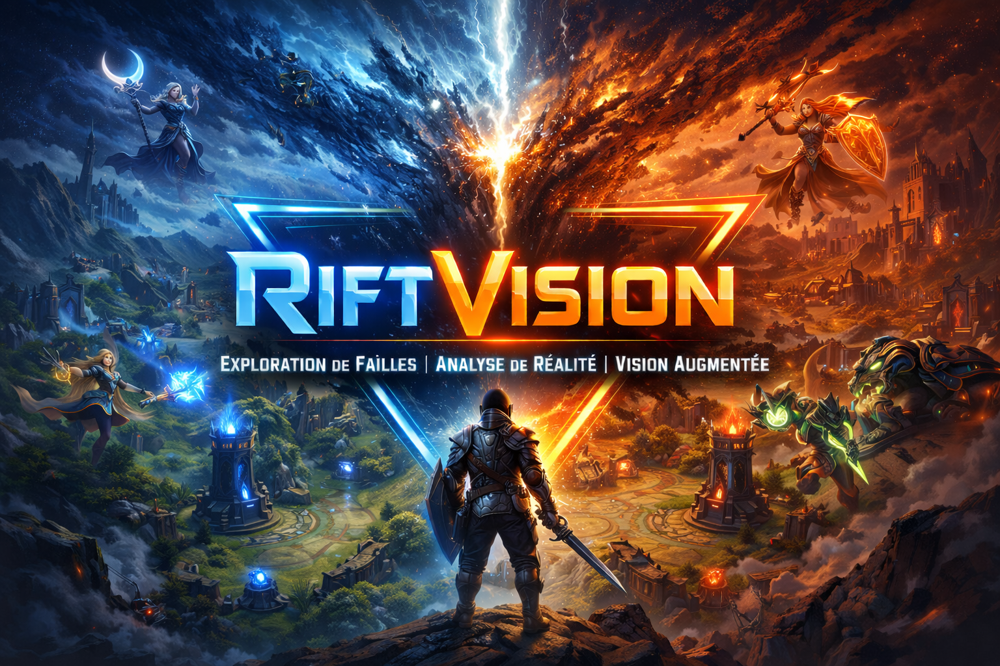

<a name="readme-top"></a>

<!-- PROJECT SHIELDS -->
[![Contributors][contributors-shield]][contributors-url]
[![Forks][forks-shield]][forks-url]
[![Stargazers][stars-shield]][stars-url]
[![Issues][issues-shield]][issues-url]
[![MIT License][license-shield]][license-url]
[![LinkedIn][linkedin-shield]][linkedin-url]

<!-- ABOUT THE PROJECT -->
# 🎮 RiftVision

<p align="center">
  <a href="http://localhost:3000">
    
  </a>
</p>

### ℹ️ Description

**RiftVision** est un copilote tactique pour **League of Legends** combinant un tableau de bord web « second screen » pour les analyses d'équipe et un **compagnon overlay tête haute (HUD) in-game**, affichant les alertes d'impact en surimpression directe sur votre écran de jeu sans jamais gêner vos clics.

- 🧭 **Connexion directe** : Dialogue local avec la **Live Client Data API** officielle de Riot (`https://127.0.0.1:2999`).
- 🎮 **3 Modes de fonctionnement** :
  - **Veille (Standby)** : Démarrage propre et silencieux sans requêtes agressives ni erreurs de timeout dans le vide.
  - **Mode Simulation (Démo)** : Instantané réel d'une partie (16:45) pour prototyper et tester sans client LoL actif.
  - **Mode Live** : Écoute explicite et synchronisation automatique avec le jeu en cours.
- 👓 **Overlay In-Game Transparent (HUD)** : Compagnon desktop ultra-léger (Electron), 100% traversant à la souris (*click-through*), superposé au jeu en mode *Plein écran fenêtré (Borderless)*.
- ⚡ **Stack moderne** : Nuxt 4 (Vue 3), TypeScript, Tailwind CSS et Nuxt UI.
- 🎨 **Icônes Font Awesome** : composant Vue officiel enregistré par un plugin Nuxt, utilisé pour l’interface et les liens du footer. Seules les icônes nécessaires sont importées.
- 🔊 **Alertes audio** : 17 fichiers WAV intégrés, sons contextuels synthétisés et commande pour couper ou réactiver le son.
- 🧹 **Outillage performant** : **Biome** pour le linting et le formatage ultra-rapide.
- 🧪 **Qualité & Tests** : Tests unitaires via **Vitest** et tests E2E via **Playwright**.
- 🐳 **Développement Docker** : réseau hôte pour joindre le client LoL (`127.0.0.1:2999`) depuis WSL2 en mode mirrored, code monté en volume et hot reload avec polling toutes les 300 ms.

---

## ⚖️ Conformité Riot Games & Fair Play

RiftVision est conçu dans le respect strict des **Riot Games Developer Policies** :
1. **Aucune injection mémoire ni altération de client** : L'application n'injecte aucun code et ne lit pas la mémoire du jeu. Elle consulte uniquement l'API locale HTTP mise à disposition par Riot Games pendant les parties.
2. **Pas d'avantage déloyal (*Unfair Advantage*)** : Toutes les informations affichées proviennent exclusivement des données publiques délivrées par l'API officielle (aucune information cachée par le brouillard de guerre n'est révélée illégalement).
3. **Mention légale obligatoire** :
   > *RiftVision isn't endorsed by Riot Games and doesn't reflect the views or opinions of Riot Games or anyone officially involved in producing or managing Riot Games properties. Riot Games, and all associated properties are trademarks or registered trademarks of Riot Games, Inc.*

---

## 🎮 Compagnon Overlay In-Game (HUD Transparent)

En complément du tableau de bord second écran, RiftVision propose un **overlay tête haute (HUD)** natif ultra-léger propulsé par Electron :

- 🪟 **Totalement transparent et sans bordure** : S'intègre naturellement par-dessus League of Legends en mode *Plein écran fenêtré (Borderless)*.
- 🖱️ **100% Traversant (Click-Through)** : Grâce à l'API `setIgnoreMouseEvents(true, { forward: true })`, aucun clic de souris ou déplacement n'est intercepté en cours de jeu. Vous conservez un contrôle parfait et sans latence de votre personnage.
- 🎯 **Positionnement rehaussé & Calibration Drag & Drop (F8)** : Par défaut, les alertes s'affichent à **8% du haut** de l'écran pour ne jamais masquer votre personnage ou vos sbires. Une pression sur **F8** active le mode calibration, permettant de glisser-déposer l'alerte à la souris où vous le souhaitez. Les coordonnées sont automatiquement enregistrées en local.
- 📌 **Barre des tâches (System Tray)** : Se loge discrètement dans la zone de notification Windows avec notification native et menu contextuel clic-droit complet (Statut, Ouvrir le tableau de bord, Calibrer la position F8, Tester F9, Masquer/Afficher Ctrl+Shift+O, Options, À propos, et Quitter proprement).
- 🌐 **Lancement automatique du Dashboard** : Ouvre immédiatement le tableau de bord tactique dans votre navigateur web par défaut dès le démarrage de l'exécutable.
- ⚡ **Synchronisation instantanée (< 5ms)** : Relié au serveur RiftVision via un pont **Server-Sent Events (SSE)** (`/api/alerts/stream`). Tout événement déclenché depuis le second écran ou détecté en partie apparaît instantanément en jeu.
- 🔌 **Indicateur d'état en direct** : La barre d'outils du dashboard affiche `Overlay HUD actif` avec une pastille lumineuse dès que le compagnon est connecté.
- ⌨️ **Raccourcis & Commandes** :
  - **F8** : Active / désactive le mode de calibration pour déplacer la bannière d'alerte à la souris (Drag & Drop) ou aux touches fléchées.
  - **F9** : Déclenche immédiatement une alerte de test in-game depuis n'importe où.
  - **Ctrl + Shift + O** : Masque ou réaffiche l'overlay à la volée en cours de partie.
  - **Bouton « Overlay HUD » (Dashboard)** : Envoie une alerte de test au compagnon ou ouvre la modale d'aide pas-à-pas s'il n'est pas encore connecté.

### 🏆 Bilan de fin de match & Historique des parties

Dès la destruction du Nexus (événement `GameEnd`) ou via le bouton **« Bilan de match »**, RiftVision ouvre un récapitulatif complet qui **reste affiché même après la fermeture du client de jeu League of Legends** :
- **Persistance locale automatique** : Chaque partie complétée est archivée dans `server/data/match-history.json` (jusqu'à 50 matchs) avec miroir de secours `localStorage`.
- **Modale « Historique des parties »** : Accessible via le bouton **Historique** dans l'en-tête et sur la page d'accueil avec affichage du résultat, du champion, de la durée, du ratio KDA, des CS/min et de l'écart économique.
- **Réouverture en 1 clic** : Réouverture intégrale de n'importe quel rapport de match antérieur avec ses onglets détaillés.
- **Bannière Victoire / Défaite** : Durée de jeu, carte et équipe associée.
- **Fiche de performance individuelle** : KDA, ratio KDA, % participation aux éliminations (% KP), sbires totaux et rythme (CS/min), score de vision et valeur d'équipement.
- **Équipement final** : Les 6 slots d'objets complétés avec portraits Data Dragon et la relique de vision.
- **Comparatif face-à-face d'équipe** : Kills, Dragons abattus, Barons Nashor, Tourelles détruites et or total d'équipement (&Delta; Gold).
- **Faits marquants** : Historique horodaté des moments décisifs (Premier Sang, Dragons, Barons, Hérauts, Séries d'éliminations, Ace).
- **Export en 1 clic** : Bouton pour copier instantanément un résumé propre dans le presse-papier.

### ⏱️ Précision des Timers d'Objectifs Neutres (Patch 14.8 Saison 14)
- **Larves du Néant (Voidgrubs)** : Apparition initiale calée à **6:00** (360s). Gestion des vagues multiples (3 larves par vague, respawn de la vague 2 après 4:00 si éliminée avant 9:45), et despawn automatique à 13:45 pour le Héraut de 14:00.
- **Dragon Ancestral** : Conditionné à l'obtention de l'Âme de Dragon (4 dragons d'une même équipe), garantissant des timers de respawn exacts à chaque étape de la partie.

### Lancement et distribution du compagnon

#### En développement :
```bash
# Lancer l'overlay avec Electron (nécessite que le serveur Nuxt tourne sur http://localhost:3000)
npm run overlay
```
Sous Windows, vous pouvez aussi double-cliquer sur `scripts/start-overlay.bat` ou exécuter `scripts/start-overlay.ps1`.

#### En production (Installateur officiel Windows .exe) :
Pour distribuer le compagnon aux utilisateurs finaux **sans leur demander d'installer Node.js ni d'utiliser un terminal** :
```bash
npm run overlay:build
```
Cette commande génère un installateur graphique Windows complet `RiftVision-Overlay-Setup-1.3.0.exe` dans le dossier `dist-overlay/` :
- **Assistant pas-à-pas** : Étapes claires (Présentation, Choix du dossier avec bouton *Parcourir...*, Raccourcis Bureau et Menu Démarrer, Installation, Lancement).
- **Téléchargement direct depuis l'application web** : Le tableau de bord propose un bouton direct **« Télécharger l'application (.exe) »** connecté à la route `/api/download/overlay`.
- **Détails & Informations** : Affichage des recommandations (mode Plein écran fenêtré) directement dans l'assistant.

> [!NOTE]
> **Avertissement « Éditeur inconnu » (Windows SmartScreen) :**
> Lors du premier lancement sous Windows d'une application open-source sans certificat d'autorité payant, Windows Defender SmartScreen peut afficher un écran bleu protecteur. Cliquez simplement sur **« Informations complémentaires »** puis **« Exécuter quand même »** pour poursuivre l'installation.

---

## 🚀 Progression & Roadmap

- [x] **v0 — Socle, Infra & Interfaçage API**
  - [x] Configuration Nuxt 4 + Biome + Docker
  - [x] Typage TypeScript exhaustif de la Live Client Data API
  - [x] Client HTTP serveur avec gestion du certificat SSL auto-signé de Riot
  - [x] Endpoints API (`/api/riot/status`, `/api/riot/live`, `/api/riot/events`, `/api/riot/mock`)
  - [x] Console de diagnostic second screen avec bascule Mode Simulation (Mock)
  - [x] Suite de tests unitaires Vitest et tests E2E Playwright
- [x] **v0.5 — Collecte, Moteur de Diff & Dashboard Brut**
  - [x] Moteur de diff temps réel pur (achats d'objets, kills, respawns, objectifs neutres & tourelles)
  - [x] Calcul de l'économie d'équipe (valeur totale d'inventaire, $\Delta$ d'or Bleue vs Rouge)
  - [x] Intégration CDN Riot Data Dragon (icônes d'items, portraits de champions officiels)
  - [x] Tableau de bord tactique face-à-face (scoreboards, KDA, inventaires 6+1 slots, barres d'économie)
  - [x] Journal d'événements et de détections dynamique filtrable par catégorie
  - [x] Gestion explicite du mode Live et veille silencieuse (v0.2.1)
  - [x] Tests unitaires et E2E du moteur de diff et du tableau de bord
- [x] **v1 — Expérience Second Screen Complète**
  - [x] Double vue ergonomique adaptée : **⚔️ Dashboard Global** vs **🎯 Focus Radar & Alertes** (`FocusRadarView.vue`)
  - [x] Moteur de projection & repères 2D de la Faille (`shared/utils/mapCoordinates.ts`)
  - [x] Minimap interactive grand format avec repères par rôle pour les 10 champions, objectifs et tourelles (`TacticalMinimap.vue`)
  - [x] Bannières Flash Alertes géantes d'impact maximal (slam, lueurs néon, progress bar 4s) (`FlashAlertOverlay.vue`)
  - [x] Alertes sonores contextuelles : 17 fichiers WAV intégrés, synthèse Web Audio et secours synthétisé si la lecture d’un fichier échoue
  - [x] Tests unitaires et E2E de la carte, des alertes et des effets sonores
- [x] **v1.1 — Refonte UI / UX & Ergonomie**
  - [x] Dashboard avec carte permanente, journal de combat filtrable et recherchable, scores et inventaires
  - [x] Carte immersive adaptée à l'écran, journal escamotable et plein écran natif
  - [x] Alertes compactes et repérage dynamique des événements localisables sur la carte
  - [x] Sélection d'événements et détails des champions accessibles au clavier
  - [x] Navigation simplifiée, affichage responsive et identité Hextech conservée
  - [x] Intégration Font Awesome pour les icônes de l’interface et du footer
  - [x] Hot reload Docker / WSL2 avec polling et procédure de synchronisation des dépendances
- [x] **v1.3 — Compagnon Desktop, Overlay HUD & Bilan de match**
  - [x] Compagnon Electron transparent 100% traversant à la souris (*click-through*)
  - [x] Intégration Barre des tâches (System Tray) avec menu contextuel et fermeture propre
  - [x] Lancement automatique du tableau de bord dans le navigateur par défaut
  - [x] Installateur Windows NSIS interactif avec choix de dossier d'installation (`RiftVision-Overlay-Setup-1.3.0.exe`)
  - [x] Route de téléchargement direct `/api/download/overlay` et landing page avec statut compagnon
  - [x] Bilan de fin de match complet (KDA, % KP, CS/min, inventaire final, comparatif d'objectifs, faits marquants et export presse-papier)
- [ ] **Tests live entre amis sur VPS — à développer**
  - [ ] Programme compagnon Windows pour lire l’API locale sur le PC de chaque joueur
  - [ ] Association du compagnon au tableau de bord par code temporaire
  - [ ] Envoi des données au VPS via HTTPS avec authentification
  - [ ] Réception et isolation des données par session de joueur
  - [ ] Affichage de l’état de connexion du compagnon et gestion des déconnexions
  - [ ] Déploiement de production sur VPS avec HTTPS
- [ ] **v1.5 — Copilote Tactique & Intelligence Prédictive**
  - [ ] Détection des Power Spikes et alertes d'équipements légendaires complétés
  - [ ] Timers prédictifs de réapparition des objectifs neutres (Dragons, Baron, Héraut) avec alertes d'anticipation (60s/30s)
  - [ ] Graphique temps réel d'évolution de la courbe d'or ($\Delta$ Gold)
  - [ ] Enregistreur de session live et lecteur de replay JSON pour tests hors-partie
- [ ] **Accueil multijeu & encyclopédies — vision à construire**
  - [ ] Repenser l'accueil autour d'une galerie de jeux inspirée de MetaBot : cartes illustrées, animations au survol, navigation responsive et accessible
  - [ ] Présenter League of Legends, Teamfight Tactics, Valorant, Counter-Strike 2, Heroes of the Storm et World of Warcraft ; identifier les jeux non disponibles et prévoir des emplacements pour les futurs jeux
  - [ ] Préserver l'identité RiftVision et les parcours existants : suivi LoL, démo, historique et compagnon desktop
  - [ ] Recenser les sources, les droits d'utilisation des visuels et les conditions d'accès aux données pour chaque jeu
- [ ] **Encyclopédie League of Legends**
  - [ ] Intégrer les données et visuels Data Dragon avec gestion des versions, de la langue et du cache
  - [x] Ajouter une recherche et des filtres pour les champions, avec fiches détaillées (compétences, statistiques de base et visuels)
  - [x] Ajouter les catalogues d'objets et de runes avec recherche, filtres et fiches
  - [x] Ajouter une recherche commune aux champions, objets et runes disponibles
  - [x] Proposer les notes de patch et leur historique, avec liens vers les publications officielles
  - [ ] Étudier les builds, classements, taux de victoire et affrontements : sources, collecte, échantillons et conditions d'accès à valider avant implémentation
- [ ] **Encyclopédies des autres jeux**
  - [ ] Teamfight Tactics : explorer les données de sets, unités, traits et objets ; ajouter recherche et fiches selon les données disponibles
  - [ ] Valorant : explorer les données d'agents, armes et cartes ; ajouter recherche et fiches selon les données disponibles
  - [ ] World of Warcraft : définir le périmètre (versions du jeu et contenus), puis explorer les sources et les possibilités de recherche et de fiches
  - [ ] Étudier les notes de patch pour chaque jeu et les intégrer lorsque les sources et leurs conditions d'utilisation le permettent
  - [ ] Étendre progressivement la recherche commune, les guides et les statistiques aux jeux pris en charge

---

## Suivre une partie

1. **Connecter ma partie** : lancez une partie de League of Legends sur l’ordinateur où RiftVision est installé, puis connectez-la depuis l’accueil. Le tableau de bord s’ouvre automatiquement dès la détection ; vous pouvez annuler la recherche à tout moment.
2. **Explorer la démo** : sans partie en cours, découvrez un exemple figé à 16:45. Le bandeau permet de tester une alerte, de connecter votre propre partie ou de quitter la démo.
3. **Suivre le tableau de bord** : consultez la carte, les événements, les scores et les inventaires. Sélectionnez un champion ou un événement pour afficher son détail.
4. **Agrandir la carte** : depuis la carte, passez à un affichage plus large, masquez le journal ou activez le plein écran. Revenez au tableau de bord avec le bouton de retour. La recherche, le filtre et l’événement sélectionné sont conservés entre ces affichages et lors d’un passage dans l’aide.

**Son et aide :** le bouton audio indique si le son est activé. **Aide et réglages** explique la connexion et la lecture des données. Le volet **Diagnostic technique** regroupe les données brutes, la vérification de connexion, la pause du suivi et les tests détaillés d’alertes en démo. Si le suivi est en pause, le bandeau de partie permet de le reprendre directement.

**Lecture de la carte :** les données exploitées ne fournissent pas les coordonnées des champions. Leurs positions sont des repères indicatifs par rôle ; les alertes d'objectifs et de tourelles s'appuient sur les repères correspondants. La valeur des inventaires sert d'indicateur d'économie et ne représente pas l'or total gagné.

## Données Data Dragon

Le serveur prépare l'encyclopédie League of Legends à partir des fichiers officiels [Data Dragon](https://developer.riotgames.com/docs/lol#data-dragon). Il utilise la dernière version disponible et la langue `fr_FR` :

Depuis l'espace League of Legends, la rubrique **Champions** permet de rechercher un champion par nom ou titre, de filtrer par classe et d'ouvrir sa fiche. Les descriptions et statistiques affichées proviennent de la version Data Dragon indiquée sur la page.

Les rubriques **Objets** et **Runes** proposent également des recherches et des filtres. Le catalogue d'objets présente les objets achetables dans la Faille de l'invocateur ; les runes sont regroupées par voie.

Le bouton **Rechercher** permet aussi de trouver ces contenus depuis l'accueil et les pages de l'encyclopédie. Les résultats sont limités à huit par catégorie ; une recherche plus précise permet d'affiner la liste. Cette recherche ne couvre pas les comptes de joueurs.

La rubrique **Notes de patch** liste les titres et dates de l'[archive officielle Riot](https://www.leagueoflegends.com/fr-fr/news/tags/patch-notes/) et renvoie vers les articles complets. Le serveur lit les métadonnées intégrées à cette page et les conserve en mémoire pendant une heure. Ce format n'est pas une API publique documentée : s'il change ou si Riot est indisponible, la page propose un lien direct vers l'archive officielle.

- `GET /api/ddragon/version` : version et langue utilisées.
- `GET /api/ddragon/champions` : catalogue des champions.
- `GET /api/ddragon/champions/Ahri` : fiche d'un champion identifié par son identifiant Data Dragon.
- `GET /api/ddragon/items` : objets achetables dans la Faille de l'invocateur.
- `GET /api/ddragon/runes` : runes regroupées par voie.

La version est conservée en mémoire une heure et les fichiers de données 24 heures, par processus serveur. Un redémarrage vide ce cache. Si Riot est indisponible ou renvoie des données invalides, l'API répond `503` ; un identifiant de champion inconnu répond `404`. Data Dragon peut être mis à jour après le patch du jeu : la version affichée est celle des données disponibles, pas nécessairement celle du client LoL. Les écrans de partie utilisent encore leurs utilitaires d'images existants.

---

## 💻 Installation & Démarrage

### Prérequis
* Node.js 22.x ou 24.x pour le développement et la suite de tests (Vitest 5 nécessite Node.js `^22.12.0`, `^24.0.0` ou `>=26.0.0`). Le Dockerfile utilise désormais Node.js 22 LTS.
* League of Legends (sur la même machine pour le mode réel) ou utilisation du mode simulation intégré

### Option A : Lancer en local

```bash
# 1. Cloner le dépôt
git clone https://github.com/nlabrazi/riftvision.git
cd riftvision

# 2. Installer les dépendances
npm install

# 3. Lancer le serveur de développement
npm run dev
# L'application est disponible sur http://localhost:3000
```

### Option B : Développer avec Docker

Cette configuration utilise **Docker Engine dans WSL2**, avec
`networkingMode=mirrored` dans le fichier `.wslconfig` Windows. Le conteneur partage
le réseau de WSL pour accéder à l'API du jeu sur `https://127.0.0.1:2999`.
Nuxt écoute directement sur le port **3000** ; le mode réseau hôte ne nécessite
pas de mapping `ports`.

Dans `.env`, définir `LIVE_CLIENT_BASE_URL=https://127.0.0.1:2999` (voir
`.env.example`). Ne pas lancer un autre serveur sur le port 3000 en parallèle.

```bash
docker compose up --build
# L'application est disponible sur http://localhost:3000
```

Le dossier généré `.nuxt` et les dépendances du conteneur utilisent des volumes
Docker dédiés pour ne pas modifier leurs équivalents locaux.

Le hot reload est actif : les modifications des composants Vue et des styles
sont appliquées dans le navigateur sans reconstruire l'image. La détection des
fichiers utilise le polling toutes les 300 ms pour fonctionner sous Docker / WSL2.
Après une modification de `docker-compose.yml`, appliquer la configuration avec
`docker compose up -d app`.

Le navigateur doit afficher `[vite] connected` dans sa console. Une sauvegarde
valide de `app/pages/index.vue` doit ensuite produire un message `[vite] hot updated`.
Une erreur de syntaxe Vue peut bloquer la mise à jour : vérifier la console du
navigateur et les logs avec `docker compose logs -f app`.

L'ajout d'une dépendance nécessite de mettre à jour le volume `node_modules` du
conteneur, puis de redémarrer Nuxt :

```bash
docker compose exec app npm ci
docker compose restart app
```

---

## 🌐 Déploiement sur VPS et parties live

**État actuel : le suivi live fonctionne avec un serveur RiftVision capable de
joindre l’API du PC qui exécute League of Legends. Le compagnon et les sessions
live distinctes pour plusieurs joueurs ne sont pas encore implémentés.**

Aujourd’hui, le navigateur appelle les routes `/api/riot/*` de Nuxt. C’est le
serveur Nuxt qui interroge ensuite l’API du jeu :

```text
Navigateur → Serveur Nuxt local → API LoL sur le PC du joueur
```

`LIVE_CLIENT_BASE_URL` est une variable côté serveur, dont la valeur par défaut
est `https://127.0.0.1:2999`. Sur un VPS, cette adresse désigne le VPS lui-même,
pas le PC du visiteur. Déployer l’application telle quelle permet d’utiliser
la démo, mais ne connecte pas les parties de vos amis.

L’architecture prévue pour les tests live entre amis est :

```text
PC de chaque joueur                         VPS
LoL → Compagnon local → HTTPS authentifié → Session du joueur → Navigateur
```

Le compagnon lira l’API locale et transmettra les données au VPS. Un code
temporaire permettra d’associer le compagnon au bon tableau de bord. Dans cette
architecture, `LIVE_CLIENT_BASE_URL` sera utilisé par le compagnon ; le VPS
recevra les données au lieu d’interroger une adresse Riot unique pour tous.
Aucun port du PC du joueur ne devra être exposé sur Internet.

Le fichier `docker-compose.yml` actuel lance **le serveur de développement** avec
hot reload. Il ne constitue pas la configuration de déploiement public. Le
Dockerfile dispose d’une cible `prod` qui compile Nuxt et lance
`node .output/server/index.mjs` ; le déploiement VPS avec HTTPS reste à mettre en
place, ainsi que le compagnon et l’API de réception pour le live distant.

---

## 🛠️ Scripts Disponibles

| Commande | Description |
| :--- | :--- |
| `npm run dev` | Démarre le serveur Nuxt en mode développement |
| `npm run build` | Compile l'application pour la production |
| `npm run lint` | Exécute le linter **Biome** sur l'ensemble du code |
| `npm run format` | Formate le code avec **Biome** |
| `npm run format:check` | Vérifie le formatage sans modifier les fichiers (idéal pour la CI) |
| `npm run test` | Exécute la suite de tests unitaires avec **Vitest** |
| `npm run e2e` | Exécute la suite de tests End-to-End avec **Playwright** |
| `npm run overlay` | Démarre le compagnon d'overlay in-game Electron (transparent et click-through) |
| `npm run overlay:build` | Génère l'installateur graphique Windows (`.exe`) dans `dist-overlay/` |

---

## 📄 Licence & Contact

Distribué sous licence **MIT**. Voir `LICENSE.txt` pour plus d'informations.

- 👤 **Nabil Labrazi** : [Portfolio](https://nabster.dev) • [LinkedIn](https://linkedin.com/in/nabil-labrazi) • [Email](mailto:na.labrazi@gmail.com)

[contributors-shield]: https://img.shields.io/github/contributors/nlabrazi/riftvision.svg?style=for-the-badge
[contributors-url]: https://github.com/nlabrazi/riftvision/graphs/contributors
[forks-shield]: https://img.shields.io/github/forks/nlabrazi/riftvision.svg?style=for-the-badge
[forks-url]: https://github.com/nlabrazi/riftvision/network/members
[stars-shield]: https://img.shields.io/github/stars/nlabrazi/riftvision.svg?style=for-the-badge
[stars-url]: https://github.com/nlabrazi/riftvision/stargazers
[issues-shield]: https://img.shields.io/github/issues/nlabrazi/riftvision.svg?style=for-the-badge
[issues-url]: https://github.com/nlabrazi/riftvision/issues
[license-shield]: https://img.shields.io/github/license/nlabrazi/riftvision.svg?style=for-the-badge
[license-url]: https://github.com/nlabrazi/riftvision/blob/master/LICENSE.txt
[linkedin-shield]: https://img.shields.io/badge/-LinkedIn-black.svg?style=for-the-badge&logo=linkedin&colorB=555
[linkedin-url]: https://linkedin.com/in/nabil-labrazi
